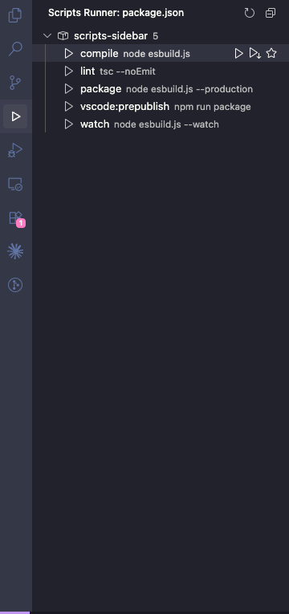

# Scripts Runner

> Run **npm, yarn, and pnpm scripts** straight from the VS Code sidebar — one click, no typing in the terminal.

[](https://marketplace.visualstudio.com/items?itemName=dothanhdao.scripts-sidebar)
[](https://marketplace.visualstudio.com/items?itemName=dothanhdao.scripts-sidebar)
[](https://marketplace.visualstudio.com/items?itemName=dothanhdao.scripts-sidebar)



## Features

### ▶️ One-click run
Every script in your `package.json` shows up in a dedicated **Scripts Runner** view on the Activity Bar. Click a script to run it, or use the inline buttons that appear on hover. Each script's command is shown right next to its name.

### 🏃 Runs in the terminal
Scripts run in VS Code's integrated terminal, so you keep full logs and support for `watch`, dev servers, and interactive commands. The terminal tab is named after the script and is reused per script.

### ↕️ Reorder scripts
Drag a script (press and hold, then move) to reorder it within its folder — put the scripts you run most at the top. The order is saved per-workspace. Scripts with no custom order stay alphabetical.

### ⏹ Stop & running state
A running script shows a spinner and a **stop** button so you always know what's live. Clicking a running script focuses its terminal instead of starting it again — no more accidentally restarting your dev server.

### 🙈 Hide scripts you don't use
Hide noisy scripts from the sidebar to keep only the ones you run — hidden scripts are removed from the view entirely. To bring them back, right-click inside the `package.json` file and choose **"Show Hidden Scripts…"**. Your choice is remembered per workspace, and newly added scripts always show up by default.

### 🔎 Status bar
- **Status bar** shows how many scripts are running — click it to stop one quickly.

### 🗂️ Stays tidy
- Fold the whole script list away — the collapsed state is remembered.
- **Monorepo friendly:** every `package.json` gets its own collapsible node.
- **Auto-detects** npm / yarn / pnpm from your lockfile.
- **Auto-refreshes** when `package.json` changes.

## Usage

1. Open a project that has a `package.json` with a `scripts` section.
2. Open the **Scripts Runner** view in the Activity Bar (left side).
3. **Click** a script to run it in the terminal. On hover you get:
   - `🙈` hide from sidebar
   - `⏹` stop (while running)
4. To show hidden scripts again: right-click in `package.json` → **Show Hidden Scripts…**

## Extension Settings

| Setting | Default | Description |
|---|---|---|
| `scriptsSidebar.packageManager` | `auto` | `auto` / `npm` / `yarn` / `pnpm`. `auto` detects from the lockfile. |
| `scriptsSidebar.reuseTerminal` | `true` | Reuse each script's terminal instead of creating a new one every run. |
| `scriptsSidebar.scanMode` | `all` | Which `package.json` files to list: `all`, `roots` (hide workspace members declared in a parent's `workspaces` / `pnpm-workspace.yaml`), or `workspaces` (roots that declare workspaces + their members). |
| `scriptsSidebar.include` | `[]` | Allowlist of globs matched against each `package.json` path relative to the workspace folder (e.g. `apps/**`). When non-empty, only matching packages are shown. |
| `scriptsSidebar.exclude` | `[]` | Blocklist of globs (e.g. `**/packages/**` to hide monorepo libraries). |

> **Monorepo tip:** if the sidebar shows too many sub-packages (e.g. `@scope/*`
> libraries that only have a `typecheck` script), set `scriptsSidebar.scanMode`
> to `roots`, or add an `exclude` glob like `**/packages/**`.
>
> You can also **remove individual groups** with the ✕ button on a folder;
> restore them later via **Show Hidden Package Groups…** in the view title.

### Per-repo config (`package.json`)

Instead of per-machine settings, a repo can declare its own filtering in the
**root `package.json`** via a `scriptsRunner` field, so everyone who opens the
repo gets the same sidebar with no manual setup:

```jsonc
{
  "name": "my-monorepo",
  "scriptsRunner": {
    "scanMode": "all",            // optional: all | roots | workspaces
    "exclude": ["**/packages/**"], // hide library sub-packages
    "include": []                  // optional allowlist
  }
}
```

How it combines with user/workspace settings:

- `include` / `exclude` are **merged** (union) with any `scriptsSidebar.*` settings.
- `scanMode` from settings wins **only if** you set it explicitly; otherwise the
  repo's `scanMode` applies, else the default `all`.

## Requirements

- VS Code `1.85.0` or newer.
- npm, yarn, or pnpm available on your `PATH` (whichever your project uses).

## Known Issues

- For scripts run in the **terminal**, the "running" indicator clears automatically when the command finishes **only if VS Code Shell Integration is enabled**. Without it, the indicator clears when you close the terminal or press stop.

## Release Notes

See the [Changelog](CHANGELOG.md) (also available on the extension's **Changelog** tab in the Marketplace) for the full version history.

---

**Enjoy!** If you find this useful, a rating on the Marketplace is appreciated. 🙌
